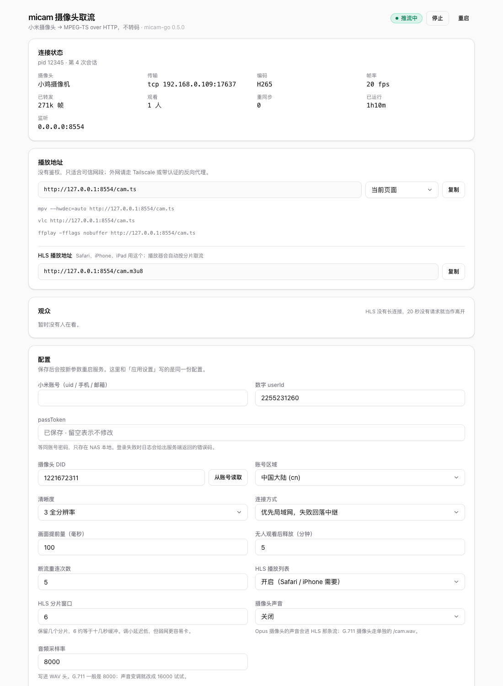

# micam-go

把小米米家摄像头变成一条 MPEG-TS over HTTP 的流，**不转码**。

登录小米云拿到会话参数，走官方 App 同款 CS2 中继，或者在同网段时直接连摄像头，建立
MISS 会话后解密媒体，原样复用成 TS 输出。协议层是
[eugeneRover/micam](https://github.com/eugeneRover/micam)（Java）的 Go 重写，两边互通。

- 单个静态二进制，`CGO_ENABLED=0`，`linux/arm64` 与 `amd64` 都直接交叉编译
- 不转码：CPU 只花在解密和 TS 复用上，输出码率等于摄像头码率
- 两种输出：`/cam.ts` 给 mpv / VLC / ffmpeg，`/cam.m3u8` 给 Safari 和 iOS
  后者还带摄像头的声音（Opus 原样复用，音画同一条流）
- 可选声音：摄像头的 Opus 原样进 TS 和 HLS 的音轨，不转码、不依赖编码器
- 优先局域网直连，失败自动回落中继
- 断流按连续失败计数重连；云接口不可达时不退出、也不占重试额度
- 可选按需拉流：没人看就断开摄像头，有人连上再重新拉（`--idle-stop`）
- fnOS 应用包自带管理界面：配置、启停、连接状态、运行日志

## 准备凭据

### userId 与 passToken

小米没有提供查看它们的界面，只能从浏览器 Cookie 里取：

1. 浏览器打开 <https://account.xiaomi.com> 并登录（就是平时登录米家 App 的账号）
2. `F12` → Application → Storage → Cookies → `https://account.xiaomi.com`
3. 过滤 `userId`，取**名字正好是 `userId`** 那一行的 Value，是一串纯数字
4. 过滤 `passToken`，取对应 Value

别拿错行：列表里还有 `cUserId`、`serviceToken`。`userId` 是数字 ID，不是手机号。

`passToken` 近似等价于账号密码，能访问该账号下的所有设备。用文件而不是命令行或环境变量
传它，权限 `600`：

```sh
printf '%s' '<passToken>' > secrets/pass_token
chmod 600 secrets/pass_token
```

想降低风险，可以用小米的「设备共享」把摄像头共享给一个小号，用那个小号登录。

### 拿 DID

```sh
micam --list-cameras --user-id 2255231260 --pass-token "$(cat secrets/pass_token)"
```

```
  DID          MODEL                     NAME    STATUS
  1221672311   xiaomi.camera.92ac1       小鸡    online
```

只做登录和 `device_list`，不建会话、不占端口。凭据缓存在 `--data-dir`（默认
`~/.micam`），之后可以省略 `--user-id` / `--pass-token`。

## 运行

### 静态二进制

从 [Releases](https://github.com/HoshinoSuzumi/micam-go/releases) 下载对应架构的文件，
放到 NAS 或任意常开的机器上：

```sh
chmod +x micam-linux-amd64
export MICAM_PASS_TOKEN_FILE=$PWD/secrets/pass_token
./micam-linux-amd64 --user-id 2255231260 --did 1221672311 --bind 0.0.0.0
# 流：http://<机器地址>:8554/cam.ts
```

`--bind` 默认是 `127.0.0.1`，只有本机能打开。要让局域网或 Tailscale 访问就改成 `0.0.0.0`
（启动日志会列出每块网卡可用的地址）。

用 systemd 常驻：

```ini
# /etc/systemd/system/micam.service
[Unit]
Description=micam
After=network-online.target

[Service]
ExecStart=/usr/local/bin/micam --did 1221672311 --bind 0.0.0.0
Environment=MICAM_PASS_TOKEN_FILE=/etc/micam/pass_token
Environment=HOME=/var/lib/micam
StateDirectory=micam
Restart=on-failure
RestartSec=10

[Install]
WantedBy=multi-user.target
```

### Docker Compose

```sh
git clone https://github.com/HoshinoSuzumi/micam-go && cd micam-go
cp .env.example .env                      # 填 MICAM_USER（数字账号 ID）与 MICAM_DID
mkdir -p data secrets
printf '%s' '<passToken>' > secrets/pass_token
sudo chown -R 10001:10001 data
sudo chown 10001:10001 secrets/pass_token
sudo chmod 400 secrets/pass_token
docker compose pull && docker compose up -d
```

镜像在 `hoshinosuzumi/micam-go`（另有 GHCR）。容器以 uid 10001 运行，`./data` 是它的
`$HOME`，会话缓存在这里。

**必须用 host 网络。** 局域网直连依赖发往 `255.255.255.255` 的广播，Docker 的 bridge
不会把它送到物理网段，摄像头收不到就会静默退回中继。host 模式下不能写 `ports:`，
8554 直接开在宿主机上。

摄像头不在同一网段（VPS 部署）时反过来用 bridge：注释 `network_mode: host`，加回
`ports: ["8554:8554"]`，并设 `MICAM_LAN=off` 省掉必然失败的 3 秒广播等待。

### fnOS 应用包

从 Releases 下载 `micam_<版本>_amd64.fpk`（x86）或 `_arm64.fpk`，在应用中心上传安装。
装好后应用卡片打开的就是管理界面：



配置、启停、连接状态、日志都在这里，不需要回「应用设置」改完等重启。几个细节：

- 配置和「应用设置」写的是同一份 `etc/micam.env`
- 会话缓存放在安装时创建的 `micam-go` 共享目录，文件管理器里可见，备份就是拷一个
  `credentials.json`
- 配置里点「从账号读取」直接列出账号下的摄像头，不用先跑命令行查 DID
- 「播放地址」按网卡列出可选地址（`enp1s0`、`tailscale0`…），选中后下面的 mpv / vlc /
  ffplay 命令跟着换，点一下即复制
- 同一个网卡选的地址下面还给出 **HLS 播放列表**地址，Safari 和 iPhone 用这一条
- 界面和 API 都在飞牛网关的 CGI 后面，不额外开端口

自己打包：

```sh
make web                        # 构建界面，需要 Node 20+
make fpk                        # 出 amd64 与 arm64 两个包
# 需要 fnpack：https://developer.fnnas.com/docs/cli/fnpack
```

包结构、目录布局和真机待确认项见 [`packaging/fnos/README.md`](packaging/fnos/README.md)。

## 配置

| 参数 | 默认 | 说明 |
|---|---|---|
| `--user` | 提示 | 小米账号（uid / 手机 / 邮箱） |
| `--user-id` | — | 数字账号 ID；用 `passToken` 登录时必填 |
| `--pass-token` | — | 浏览器复制的 `passToken`，免密码免 2FA |
| `--password` | — | 账号密码；常被 2FA 拦住，优先用 `passToken` |
| `--region` | `cn` | `cn` `de` `sg` `us` `ru` `i2` |
| `--did` | 提示 | 要取流的摄像头 DID |
| `--bind` | `127.0.0.1` | HTTP 监听地址 |
| `--port` | `8554` | HTTP 端口 |
| `--quality` | `2` | 0 auto / 1 SD / 2 HD / 3 full；协议支持到 5，新机型常把全分辨率放在 3 |
| `--pts-lead` | `100` | 画面提前量（毫秒），越小越跟手 |
| `--hls` | 开 | 同时提供 `/cam.m3u8`，Safari 和 iOS 只能播这个 |
| `--hls-window` | `6` | 播放列表保留几个分片；越多越抗抖动，越少延迟越低 |
| `--audio` | 关 | 向摄像头要声音：Opus 同时进 TS 和 HLS 的音轨，G.711 另开 `/cam.wav` |
| `--audio-rate` | `8000` | WAV 头里的采样率；G.711 一般是 8000 |
| `--lan` | `prefer` | `prefer` 先试直连再回落；`only` 只用直连；`off` 只用中继 |
| `--reconnect` | `0` | 连续断流后的重连次数；`0` 交给编排层重启 |
| `--idle-stop` | `0` | 无人观看这么多分钟后释放摄像头；`0` 表示一直拉流 |
| `--data-dir` | `~/.micam` | `credentials.json` 所在目录 |
| `--connect-timeout` | `90` | 中继握手总超时（秒） |
| `--list-cameras` | off | 只列设备后退出 |
| `--relogin` | off | 丢弃缓存会话重新登录 |
| `--dump` | — | 把裸码流写到文件，不对外提供 HTTP（配合 `--dump-seconds`） |
| `--status-file` | — | 周期性写出状态 JSON，供管理界面读取 |
| `--verbose` | off | 逐包打印 PPPP |

环境变量与参数同名（`MICAM_` 前缀），容器里改不了命令行时就用它。`MICAM_PASS_TOKEN_FILE`
是唯一没有对应参数的一个：从文件读 token，比把它放进环境变量安全——`docker inspect`
会把 env 原样打印出来。

`--relogin`、`--dump`、`--dump-seconds`、`--connect-timeout`、`--list-cameras` 只能用命令行。

`--idle-stop N` 打开按需拉流：连续 N 分钟没有观众就断开摄像头会话，下一次有人
连接时重新建立。播放器会多等两三秒，换来摄像头不再整夜空转。默认关闭。

退出码：`1` 无摄像头或传输不支持，`2` 登录 / 2FA，`3` 会话失败，`4` 摄像头离线，
`5` 无媒体，`6` 端口占用。

## 地址

| 路径 | 内容 |
|---|---|
| `/cam.ts` | MPEG-TS，给 mpv / VLC / ffmpeg |
| `/cam.m3u8` | HLS（fMP4 + Opus），Safari 和 iOS 只能播这个 |
| `/cam.wav` | G.711 音频，`--audio` 打开后才有 |
| `/healthz` | 200 表示正常：没人看算正常，有人看时要求 15 秒内有过帧，否则 503 |
| `/` | 纯文本索引，列出上面这些和当前观众数 |

`/healthz` 适合放进 Docker healthcheck 或 NAS 的监控，`/` 适合直接用浏览器打开看一眼。

## 局域网直连

摄像头与 micam 在同一网段时，先广播找它，再建立直连会话，媒体完全不走中继：

```
-> 255.255.255.255:32108   LAN_SEARCH
<-                         PUNCH_PKT（payload 是摄像头 UID）
->                         原样回送该包
<-                         P2P_RDY / P2P_RDY_TCP
   之后是普通的 DRW / MISS 流量，与中继路径一致
```

实测 `xiaomi.camera.92ac1` 有两个特点：只回应广播、忽略单播；只提供 TCP 会话。所以
`Link` 抽象同时支持 UDP 和 TCP，媒体解密那层不做区分。

`localip` 是摄像头自己上报的，换网络后可能过期；直连失败会在日志留一条
`no direct local session, using the relay` 并回落中继。

## 画质与延迟

分辨率不对先用 ffprobe 看码流：

```sh
ffprobe -v error -select_streams v -show_entries stream=width,height \
  -of csv=p=0 http://127.0.0.1:8554/cam.ts
```

低于米家 App 里看到的分辨率，就把 `--quality` 往上调；摄像头会忽略不认识的值。

延迟主要来自播放器，其次才是这条链路：

| 来源 | 量级 | 怎么减 |
|---|---|---|
| 播放器缓冲 | 2–10s | 换硬解播放器（mpv `--hwdec=auto`、PotPlayer），或调小缓存 |
| PTS 提前量 | 默认 100ms | `--pts-lead 0` 最跟手，软件解码容易丢帧 |
| 观众队列 | ≤ 25 帧 | 落后时整段丢弃、重同步到关键帧，不会累积 |
| 传输 | 局域网 <10ms / 中继 20–80ms | `--lan prefer` |

## 排错

**画面能出但报 `Could not find ref with POC`**：先确认不是播放器的问题。

```sh
ffmpeg -v error -i http://127.0.0.1:8554/cam.ts -t 10 -f null -
```

输出为空说明码流是干净的，报错来自播放器实时解码跟不上、自己丢帧。2K H.265 用软件解码
很容易触发，换硬件解码即可。也可以用 `--dump` 存一份裸码流离线比对。

**断流**：日志里的 `the camera stopped sending` 会带 `err=`，按它区分：

| `err` | 含义 | 往哪查 |
|---|---|---|
| `pppp: the camera closed the session` | 摄像头主动结束会话 | 摄像头重启、被米家 App / HA 抢占、供电 |
| `pppp: no media for the idle timeout` | 15 秒没有媒体但连接还在 | 掉电、Wi-Fi 掉线；半开连接不报错，只能靠看门狗发现 |
| `EOF` / `connection reset by peer` | 传输层断开 | 同上，通常是网络或摄像头侧 |

重连额度按**连续失败**计：会话跑满 60 秒就清零，稳跑一夜后掉线不会消耗额度。
`the Mi cloud is unreachable` 不算会话失败，既不占额度也不会 `giving up`。

**`passToken was rejected`**：`account.xiaomi.com` 返回的 `code=70016`，意思是这个
`userId` 和 `passToken` 配不上，与格式无关。按概率是 token 过期（改过密码、退过所有设备）、
浏览器登录的是另一个账号、或者复制被截断。

别从浏览器重抄，直接用 `credentials.json` 里那份，它每次登录成功都会被小米轮换后的新
token 覆盖：

```sh
jq -r .passToken ~/.micam/credentials.json
```

日志里的错误会带一个不泄密的指纹（长度 + sha256 前 8 位），可以拿来比对两份是不是同一个。

**外网打不开**：先确认 `--bind` 不是 `127.0.0.1`。`curl -I http://<地址>:8554/cam.ts`
返回 `200` 才算通；`Connection refused` 是没在听，一直卡住是防火墙。流本身没有鉴权，
只应放在可信网段，或者前面挂一层带认证的反向代理。

## 构建

```sh
go test ./...              # 只依赖 golang.org/x/crypto
make build                 # -> bin/micam
make cross                 # -> bin/micam-linux-arm64
make web && make fpk       # fnOS 应用包
```

版本号来自 git tag，构建时用 `-ldflags -X micam/internal/cli.Version=…` 注入。
`make build` 走 `scripts/version.sh`，本地显示的是 `git describe` 的结果
（例如 `0.6.2-3-gabc1234`，有未提交改动时带 `-dirty`）。

发布由 Actions 里的 `release` 工作流完成：它把版本号写回 `manifest` 和 `package.json`、
打 tag、构建多架构镜像和两个 fpk，产物挂到 GitHub Release。只需 `GITHUB_TOKEN`；
要同时推 Docker Hub，加 `DOCKERHUB_USERNAME` 和 `DOCKERHUB_TOKEN` 两个 secret。

## 目录

```
cmd/micam/              入口、参数、登录、选摄像头、串联全流程、管理 API
internal/pppp/          Frame / UID / AddrBlock / InitString / 0x28 / DRW / 中继 / 会话
internal/cloud/         登录、两步签名、RC4-drop1024、设备列表、miss_get_vendor
internal/miss/          X25519 + HSalsa20 会话密钥、ChaCha20 媒体解密
internal/ts/            MPEG-TS 复用（PAT/PMT/PES/PCR、单调时钟修复）
internal/stream/        HTTP 分发、每观众独立复用器与有界队列
internal/status/        状态文件（管理界面读它）
internal/ctl/           管理 API，作为 CGI 挂在飞牛网关下
web/                    管理界面源码（Svelte + Tailwind）
packaging/fnos/         fnOS 应用包
scripts/version.sh      从 tag 取版本号
docs/PROTOCOL.md        协议规格
docs/DESIGN.md          Go 设计与里程碑
```

协议细节看 `docs/PROTOCOL.md`，实现取舍看 `docs/DESIGN.md`。

## 许可

上游仓库未附 LICENSE（默认保留所有权利）。本仓库是自用重写的实现与笔记；分发镜像或
衍生作品前，请先与上游作者确认。
